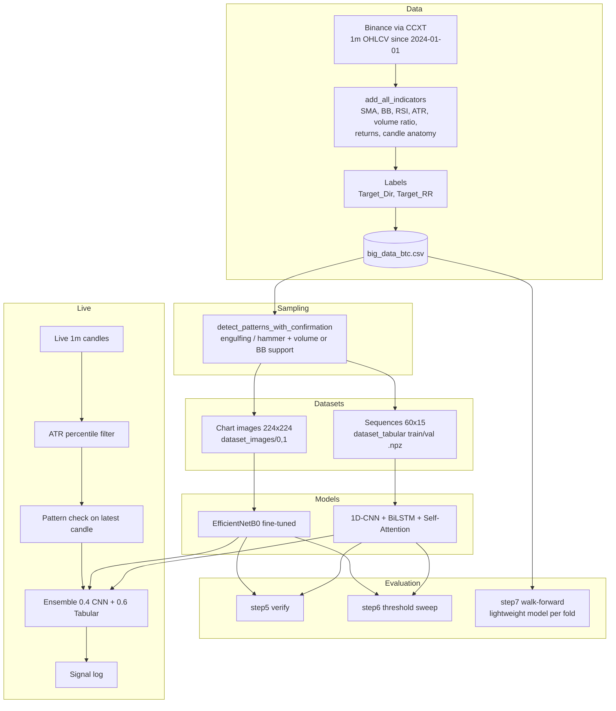

# Project Document: ML-Powered Algorithmic Trading System (Computer Vision)

**Author:** Abdelrahman Mostafa Kamal ([@bodymostafa1](https://github.com/bodymostafa1))
**Repository:** [bodymostafa1/ML-Powered-Algorithmic-Trading-System-Computer-Vision-](https://github.com/bodymostafa1/ML-Powered-Algorithmic-Trading-System-Computer-Vision-)
**Domain:** Financial time series / applied deep learning
**Asset & granularity:** BTC/USDT, 1-minute candles (Binance via CCXT)
**Status:** Research prototype (signal generation only; no order execution). Sequence model evaluated; image model implemented, not yet trained.

---

## 1. Executive Summary

This project investigates whether deep learning can identify high-quality short-term long setups in BTC/USDT after classic candlestick patterns appear. Instead of predicting every candle, the system first **filters for volume-confirmed pattern setups**, then asks two different models whether the setup is likely to be followed by a favorable risk/reward move within the next 15 minutes:

1. A **computer-vision model** that looks at a rendered candlestick chart (price, SMA, Bollinger Bands, volume and RSI panels).
2. A **sequence model** that reads the exact numeric values of the last 60 candles and 15 engineered features.

Their probabilities are blended in a weighted ensemble and passed through an ATR volatility gate before a signal is emitted. The repository also includes a verification suite, a threshold optimizer with profit/loss simulation, and a walk-forward backtester.

**Outcome so far:** the sequence model reaches a validation ROC-AUC of 0.52 and a negative walk-forward P/L (-16.80 units over 18 folds), i.e. no reliable out-of-sample edge. The image model is implemented but not yet trained. The project's contribution is the pipeline and evaluation methodology; see section 16.

---

## 2. Objectives

| # | Objective | Where it is addressed |
|---|---|---|
| 1 | Build a reproducible data pipeline from raw exchange data to model-ready datasets | `step1`, `step2_*`, `config.py`, `utils.py` |
| 2 | Compare image-based and numeric-sequence representations of the same setups | `step3_train_model.py`, `step3_train_tabular.py` |
| 3 | Define labels that account for risk, not just direction | `utils.create_risk_adjusted_labels` |
| 4 | Evaluate with time-aware methods rather than random splits | chronological split, `step7_walkforward.py` |
| 5 | Keep training and live inference consistent | shared `utils.py`, identical rendering / normalization in `step4` |

---

## 3. Scope

**In scope:** data collection, feature engineering, pattern detection, labeling, two model families, ensembling, offline evaluation, walk-forward backtesting, live signal logging.

**Out of scope:** order execution, position sizing, fees/slippage, portfolio management, multi-asset support, any claim of live profitability.

---

## 4. System Architecture



**Design principle:** `config.py` holds every tunable value and `utils.py` is the single implementation of indicators, pattern logic, labeling and the chronological split. Every script imports from them so that training, evaluation and live inference cannot silently diverge.

---

## 5. Data

### 5.1 Source
Historical 1-minute OHLCV candles for `BTC/USDT` are downloaded from Binance through CCXT in batches of 1,000 candles (with a short sleep for rate-limit courtesy), starting at `2024-01-01 00:00:00` up to the present.

### 5.2 Technical indicators (computed once in step 1)

| Feature | Definition |
|---|---|
| `SMA_20`, `BB_Upper`, `BB_Lower` | 20-period moving average and +/-2 std Bollinger Bands |
| `RSI_14` | 14-period RSI (rolling-mean gain/loss variant) |
| `ATR_14` | 14-period rolling mean of True Range |
| `Volume_Ratio` | Volume / 20-period average volume |
| `Returns` | 1-period percentage change of Close |
| `Body_Ratio` | |Close - Open| / (High - Low) |
| `Upper_Shadow`, `Lower_Shadow` | Wick length as a fraction of the candle range |

---

## 6. Labeling Methodology

Two labels are produced in `step1_data_prep.py`.

**Directional label (`Target_Dir`)** - compares the close 15 candles ahead to the current close: `1` if the change is above +0.3%, `0` if below -0.3%, `2` (flat) otherwise.

**Risk-adjusted label (`Target_RR`) - the training target.** Using the highs and lows of the next 15 candles:

```
max_gain = (max High over next 15 - Close) / Close
max_loss = (Close - min Low over next 15) / Close

label = 1  if  max_gain > 0.3%  AND  max_gain > 1.5 * max_loss
        0  otherwise
```

This replaces an earlier "max high only" approach that rewarded any upside regardless of how deep the drawdown was. Class `1` therefore means "a favorable reward/risk long setup", and class `0` means "wait".

Columns such as `Future_Close`, `Price_Change`, `Max_Gain` and `Max_Loss` are saved in the CSV for analysis but are **not** part of the 15 model input features.

---

## 7. Setup Detection (Sampling Filter)

Rather than classifying every minute, the pipeline only samples candles that match a bullish setup:

- **Bullish engulfing:** previous candle red, current candle green, current close above previous open and current open below previous close.
- **Hammer:** body <= 30% of range and lower shadow >= 60% of range.
- **Confirmation:** the pattern must occur with volume above 1.5x its 20-period average **or** with the close within 1% of the lower Bollinger Band.

A doji detector is implemented in `utils.py` but is not part of the setup filter.

---

## 8. Data Representations

### 8.1 Image dataset (`step2_pro_gen.py`)
For each setup, the previous 60 candles are rendered with `mplfinance`: green/red candles on a black background, no axes, SMA(20) in blue, Bollinger Bands as dotted white lines, a volume panel and an RSI panel (panel ratios 3:1:1). Images are saved to `dataset_images/<label>/img_<n>.png` and resized to 224x224 at load time. The same rendering style is reused by the live bot to keep train/serve behavior aligned.

### 8.2 Sequence dataset (`step2_tabular_gen.py`)
For each setup, the previous 60 candles x 15 features are extracted and **min-max normalized per feature within the window**, which makes the input invariant to absolute price level. Samples are sorted by time, split 80/20 chronologically, and saved as `train.npz` / `val.npz`.

**Why both?** The image pipeline is slow (rendering) and lossy (pixel approximation of values). The sequence pipeline is far faster and exact. Training both allows a direct comparison and an ensemble.

---

## 9. Models

### 9.1 Image model - EfficientNetB0
- ImageNet-pretrained backbone, all layers frozen except the last 20.
- Head: GlobalAveragePooling -> BatchNorm -> Dense(256, ReLU) -> Dropout(0.4) -> Dense(64, ReLU) -> Dropout(0.3) -> Dense(1, sigmoid).
- Adam, learning rate 1e-4 (0.1 x base), binary cross-entropy.
- Augmentation: small horizontal shift, small zoom, horizontal flip.
- Chosen over ResNet50 for fewer parameters on a small dataset.

### 9.2 Sequence model - 1D-CNN + BiLSTM + Self-Attention
- **1D-CNN** (64 filters k=3 -> 128 filters k=5, BatchNorm, MaxPool, Dropout) extracts local multi-candle motifs.
- **Bidirectional LSTM (64)** models temporal dependencies across the pooled sequence.
- **Custom `SelfAttention` layer** scores each timestep with a learned vector and returns a weighted context vector, so the model can emphasize the most informative candles.
- Head: Dense(128) -> BatchNorm -> Dropout(0.4) -> Dense(32) -> Dropout(0.3) -> Dense(1, sigmoid). Adam at 1e-3.

### 9.3 Shared training setup
Batch size 32, up to 30 epochs, balanced class weights, `ModelCheckpoint` and `EarlyStopping` (patience 7, restore best weights) on validation loss, and `ReduceLROnPlateau` (factor 0.3, patience 3). Global seeds (NumPy, TensorFlow, Python, `PYTHONHASHSEED`) are set in `config.set_seeds`.

### 9.4 Ensemble
```
p_ensemble = (0.4 * p_cnn + 0.6 * p_tabular) / (sum of weights of models that produced a prediction)
```
The sequence model gets the higher weight because it sees exact values. If one model is unavailable, the bot falls back to the other.

---

## 10. Evaluation Methodology

### 10.1 Chronological hold-out (`step5_verify_model.py`)
The final 20% of samples (by time) form the validation set. Reported: classification report, ROC-AUC, confusion matrix, number of signals, win rate, and a simulated P/L.

### 10.2 Threshold optimization (`step6_optimize_threshold.py`)
Sweeps thresholds from 0.50 to 0.95 (step 0.05) at payouts of 70%, 80% and 85%. For each threshold it reports win rate, trades, profit, EV per trade and the **maximum consecutive losses**, selecting the most profitable threshold with at least 10 trades.

### 10.3 Walk-forward backtest (`step7_walkforward.py`)
Rolling windows: train on 6 months of setups, test on the following month, then slide forward one month. A fresh lightweight model (Conv1D(32) -> BiLSTM(32) -> Dense) is trained per fold with early stopping. This exposes regime sensitivity and performance decay that a single hold-out cannot.

### 10.4 Simulated payoff
Win = +payout (default 0.80), loss = -1.0, based on whether the sample's label is `1`.

---

## 11. Live Inference (`step4_pattern_bot.py`)

Every minute boundary, the bot:

1. Fetches the latest 120 one-minute candles and computes all indicators.
2. **Volatility gate:** computes the ATR percentile over the fetched history and skips the minute if it is at or below the 25th percentile.
3. **Pattern check:** evaluates the same volume-confirmed pattern logic on the latest candle.
4. **Prediction:** renders a chart image for the CNN and builds a normalized 60x15 sequence for the tabular model, then forms the weighted ensemble probability.
5. **Decision:** probability above 0.60 -> CALL signal; below 0.40 -> PUT-labeled signal (experimental, see section 13); otherwise hold. Signals are printed and appended to `trade_log.txt`.

No orders are sent.

---

## 12. Engineering Decisions & Evolution

| Earlier approach | Current approach | Reason |
|---|---|---|
| Five separate image generators | One consolidated `step2_pro_gen.py` | Remove duplicated, inconsistent logic |
| Duplicated indicator code per script | `utils.add_all_indicators` | One definition for train and live |
| Random or ad-hoc splits | Chronological split | Avoid mixing future into training |
| Direction-only labels | Risk-adjusted reward/risk labels | Penalize setups with deep drawdown |
| `pct_change().std()` volatility filter | ATR percentile filter | More stable, purpose-built volatility measure |
| Any engulfing pattern | Volume-confirmed patterns with BB support | Fewer, higher-quality setups |
| Image-only model | Image + numeric sequence ensemble | Exact values instead of pixel approximations |
| ResNet50 | EfficientNetB0 with partial fine-tuning | Fewer parameters for a small dataset |
| 100x100 images | 224x224 with volume and RSI panels | More visible indicator detail |

---

## 13. Limitations & Known Issues

Documenting these openly is part of the project's value; each one maps to a concrete improvement in section 14.

**Labeling and evaluation**
1. **Label/payoff mismatch.** Labels are touch-based (maximum high/low in the window), but P/L is simulated as a binary option settled at expiry. These are different payoffs.
2. **Path ambiguity.** `max_gain` and `max_loss` do not record which occurred first, so a "good" label may include a stop-out before the target.
3. **Selection on the future.** Step 1 drops rows whose 15-minute close-to-close move was within +/-0.3%. This conditions the dataset on future volatility, and because rows are removed before windowing, some 60-candle windows span non-contiguous minutes.
4. **Threshold tuning on validation data.** The same validation split is used for checkpointing and for threshold selection, which makes the reported numbers optimistic. Step 7 is the stricter check.
5. **Walk-forward boundary.** Training labels near a fold boundary look 15 minutes into the test period; an embargo gap would remove this overlap.
6. **Ensemble alignment.** Step 5 ensembles CNN and tabular predictions by position and only checks equal lengths; it does not verify that both models saw the same samples in the same order.
7. **No trading frictions.** Fees, spreads and slippage are not modeled.

**Modeling**
8. **Long-only target.** Class 0 means "wait", not "down". The PUT branch in the bot interprets a low probability as bearish, which the training objective does not support.
9. **Horizontal-flip augmentation.** Flipping a chart reverses the time axis, so it does not preserve market semantics.
10. **Per-column OHLC scaling.** Open/High/Low/Close are each min-max scaled with their own range, which slightly distorts relative geometry between them.
11. **Input scaling for EfficientNet.** Images are rescaled to [0, 1] before an ImageNet EfficientNetB0 that expects raw 0-255 pixels and normalizes internally.
12. **Custom layer loading.** `SelfAttention` must be registered (or passed through `custom_objects`) wherever the saved tabular model is reloaded.

**Live behavior**
13. **Forming candle.** The latest candle returned by the exchange is still in progress when the bot samples it, so the pattern and volume checks on `iloc[-1]` use partial data.
14. **Single regime.** Data covers BTC/USDT from 2024 onward only.
15. **RSI variant.** The RSI uses simple rolling means rather than Wilder's exponential smoothing, despite the docstring.

---

## 14. Future Work

1. Build windows on contiguous candles and compute labels without filtering on the future outcome.
2. Switch to **triple-barrier labels** (take-profit, stop-loss, time barrier) with explicit event ordering, and make the simulator consistent with them.
3. Add fees and slippage; report risk-adjusted metrics (Sharpe, max drawdown, profit factor).
4. Select thresholds on a separate calibration set; calibrate probabilities (Platt / isotonic).
5. Add an embargo/purge gap in walk-forward folds.
6. Train a proper two-sided (long/short/flat) model.
7. Evaluate on more assets and timeframes; test robustness across regimes.
8. Add experiment tracking (MLflow) and a paper-trading execution adapter.
9. Unit tests for `utils.py` (indicators, pattern detection, label logic).

---

## 15. Reproducibility

- Global seeds set in `config.set_seeds` (default `SEED = 42`).
- All hyperparameters in `config.py`.
- Execution order: `step1` -> `step2_tabular_gen` and `step2_pro_gen` -> `step3_train_tabular` and `step3_train_model` -> `step5` -> `step6` -> `step7` -> `step4`.
- Generated artifacts (data CSV, image dataset, `.npz` files, `.keras` models, logs) are large and should not be committed; see `.gitignore`.

---

## 16. Results

> **Scope of these results:** only the sequence model (1D-CNN + BiLSTM + Attention) has been trained and evaluated. The image CNN requires generating the chart-image dataset first (`step2_pro_gen.py`), which is slow, so it is not yet trained; ensemble numbers are therefore not available.

### 16.1 Hold-out evaluation (chronological 80/20 split)

| Metric | Image CNN | Sequence model | Ensemble |
|---|---|---|---|
| Training / validation samples | not trained | 61,813 / 15,454 | not available |
| ROC-AUC | - | 0.5215 | - |
| Threshold used | - | 0.60 | - |
| Signals at 0.60 | - | 1 (1 win) | - |
| Precision / Recall (Buy) at 0.60 | - | 1.00 / ~0.00 (single signal) | - |
| Simulated EV per trade at 0.60 | - | +0.80 (single trade) | - |
| Trades at 0.55 / longest losing streak | - | 381 / 12 | - |

At the 0.60 threshold the model produced a single signal, so its win rate and EV there are statistical noise and should not be read as performance.

<!-- Optional: paste the full step 6 threshold table here (win rate, profit and EV at each threshold and payout). -->

### 16.2 Walk-forward (6 months train / 1 month test, 18 folds)

| Metric | Value |
|---|---|
| Folds | 18 |
| Total simulated P/L (80% payout, 1-unit stake) | -16.80 |
| Average per-fold win rate | 17.02% |
| Best fold | #16, test Oct-Nov 2025: +4.60, 70.6% win rate (about 17 trades) |
| Worst fold | #3, test Sep-Oct 2024: -11.40, 50% win rate (about 114 trades) |

Trade counts for the best and worst folds are implied from their P/L and win rate at an 80% payout.

### 16.3 Interpretation

- **No demonstrated edge.** A validation ROC-AUC of 0.52 is barely above random (0.50). Early stopping (patience 7) stopped at epoch 8 and restored the epoch-1 weights, meaning validation loss never improved after the first epoch: the model did not learn a pattern that generalizes to the later 20% of the data.
- **The 17.02% average win rate is misleading on its own.** The backtester records a win rate of 0 for folds with no signals, so the average mixes "no trades" with "lost trades". Total P/L and per-fold trade counts are more informative; the total is negative.
- **Break-even is 55.6%.** With an 80% payout and a 1-unit loss, a strategy needs a win rate above 1 / 1.8 = 55.6% to be profitable before fees. The worst fold's 50% on roughly 114 trades is below that; the best fold's 70.6% rests on only about 17 trades and is not statistically reliable.
- **High fold-to-fold variance and sparse signals.** Several folds produced no signals at the 0.60 threshold, consistent with probabilities clustering near 0.5 under balanced class weights. P/L swings between folds are driven mostly by how many trades were taken.
- **Weakest and strongest periods (hypotheses, not verified).** Sep-Oct 2024 (fold 3) was the largest loss; folds 8-9 (Feb-Apr 2025) were also negative; Oct-Nov 2025 (fold 16) was the best. It is plausible that choppy, range-bound periods are harder, but this has not been tested against a regime indicator.
- **Likely contributors** (see section 13): labels that do not match the simulated payoff, dataset filtering that conditions on future moves and breaks window contiguity, per-column window normalization, and the inherently low signal-to-noise ratio of 1-minute crypto data over a 15-minute horizon. Fixing these and re-running is the first item of future work.

### 16.4 Conclusion

The project delivers a complete, reproducible research pipeline and an honest evaluation framework, and the evaluation correctly shows that the current model should not be traded. That outcome is a legitimate result: the walk-forward and threshold-simulation tooling did its job by exposing the lack of edge rather than hiding it behind a single favorable hold-out number.

---

## 17. Skills Demonstrated

Time-series feature engineering - computer vision transfer learning (EfficientNetB0) - sequence modeling (Conv1D, BiLSTM, custom attention layer) - label design under reward/risk constraints - leakage-aware chronological evaluation - walk-forward backtesting - class imbalance handling - modular, config-driven ML pipelines - live inference with train/serve consistency.
