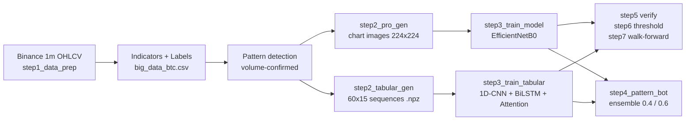

# ML-Powered Algorithmic Trading System (Computer Vision)

An end-to-end machine learning pipeline for short-horizon BTC/USDT trading signals. It downloads 1-minute candles from Binance, detects candlestick setups, converts them into **two representations** (rendered chart images and exact numeric sequences), trains a **CNN** and a **1D-CNN + BiLSTM + Attention** model, and combines both in a live **ensemble signal bot** with an ATR volatility filter.

> **Disclaimer:** This is an educational / research project. It is **not** financial advice. Current results show no reliable out-of-sample edge (see [Results](#results)), so it should not be used for real-money trading. The live bot only prints and logs signals; it does not place orders.

---

## Highlights

- **Dual-modality learning** - the same market setups are fed to an image model (EfficientNetB0 on candlestick charts with SMA, Bollinger Bands, volume and RSI panels) and to a sequence model (60 candles x 15 numeric features).
- **Setup-based sampling** - samples are generated only where a volume-confirmed bullish engulfing or hammer pattern appears, not on every candle.
- **Risk-adjusted labels** - a sample is a "Buy" only if the next 15 minutes offer >= 0.3% upside **and** upside >= 1.5x the downside.
- **Chronological splits only** - no random shuffling across time; class weighting for imbalance.
- **Walk-forward backtester** - rolling 6-month train / 1-month test folds to check stability across market regimes.
- **Threshold optimizer with P/L simulation** - sweeps confidence thresholds and payout ratios, reports win rate, EV per trade and max losing streak.
- **Single source of truth** - shared `config.py` and `utils.py` keep indicator math, pattern detection and preprocessing identical between training and live inference.

---

## Pipeline



| Script | Purpose | Output |
|---|---|---|
| `config.py` | All hyperparameters, paths, seeds | - |
| `utils.py` | Indicators, pattern detection, labeling, chronological split | - |
| `step1_data_prep.py` | Download candles, add indicators, label | `big_data_btc.csv` |
| `step2_pro_gen.py` | Render candlestick images at pattern locations | `dataset_images/{0,1}/` |
| `step2_tabular_gen.py` | Build normalized 60x15 sequences | `dataset_tabular/{train,val}.npz` |
| `step3_train_model.py` | Train the image CNN | `best_cnn_model.keras` |
| `step3_train_tabular.py` | Train the sequence model | `best_tabular_model.keras` |
| `step4_pattern_bot.py` | Live ensemble signal bot | `trade_log.txt` |
| `step5_verify_model.py` | Metrics, ROC-AUC, confusion matrices, P/L | `confusion_matrix_*.png` |
| `step6_optimize_threshold.py` | Threshold x payout sweep | console report |
| `step7_walkforward.py` | Rolling walk-forward backtest | `walkforward_results.csv` |

---

## Models

**Image model (secondary, weight 0.4)** - EfficientNetB0 (ImageNet weights), last 20 layers fine-tuned, followed by GlobalAveragePooling -> BatchNorm -> Dense(256) -> Dropout(0.4) -> Dense(64) -> Dropout(0.3) -> sigmoid. Adam at 1e-4, binary cross-entropy.

**Sequence model (primary, weight 0.6)** - Conv1D(64, k=3) -> Conv1D(128, k=5) -> MaxPool -> Bidirectional LSTM(64) -> custom self-attention over timesteps -> Dense(128) -> Dense(32) -> sigmoid. Adam at 1e-3.

**Sequence features (15):** Open, High, Low, Close, Volume, SMA_20, BB_Upper, BB_Lower, RSI_14, ATR_14, Volume_Ratio, Returns, Body_Ratio, Upper_Shadow, Lower_Shadow. Each 60-candle window is min-max normalized per feature.

**Live decision rule:** ATR must be above the 25th percentile of recent history -> pattern must fire on the latest candle -> ensemble probability > 0.60 gives a CALL signal.

---

## Getting Started

### 1. Install

```bash
git clone https://github.com/bodymostafa1/ML-Powered-Algorithmic-Trading-System-Computer-Vision-.git
cd ML-Powered-Algorithmic-Trading-System-Computer-Vision-
python -m venv .venv && source .venv/bin/activate   # Windows: .venv\Scripts\activate
pip install -r requirements.txt
```

### 2. Run the pipeline

```bash
python step1_data_prep.py          # download + label (large download: 1m candles since 2024-01-01)
python step2_tabular_gen.py        # fast: numeric sequences
python step2_pro_gen.py            # slow: chart images
python step3_train_tabular.py      # train sequence model
python step3_train_model.py        # train image model
python step5_verify_model.py       # evaluate on chronological validation set
python step6_optimize_threshold.py # find a confidence threshold
python step7_walkforward.py        # rolling out-of-sample backtest
python step4_pattern_bot.py        # live signal bot (prints + logs signals only)
```

You can train just the sequence model and skip the image steps; the bot loads whichever models exist.

### 3. Configure

Everything lives in `config.py`:

| Parameter | Default | Meaning |
|---|---|---|
| `SYMBOL` / `TIMEFRAME` | `BTC/USDT` / `1m` | Market and candle size |
| `SINCE_DATE` | `2024-01-01` | Start of historical download |
| `LOOK_AHEAD` | `15` | Minutes ahead used for labels |
| `PROFIT_TARGET` | `0.003` | Minimum upside (0.3%) for a Buy label |
| `REWARD_RISK_RATIO` | `1.5` | Upside must exceed downside by this factor |
| `IMG_WINDOW` / `SEQUENCE_LENGTH` | `60` | Candles per sample |
| `ENSEMBLE_WEIGHTS` | `cnn 0.4 / tabular 0.6` | Model blend |
| `CONFIDENCE_THRESHOLD` | `0.60` | Signal cutoff (tune with step 6) |
| `MIN_ATR_PERCENTILE` | `25` | Skip trading in the quietest 25% of volatility |

---

## Results

> **Status:** results below are for the **sequence model only**. The image CNN pipeline (`step2_pro_gen.py` -> `step3_train_model.py`) is implemented but has not been trained or evaluated yet, so it is not included in the comparison or the ensemble numbers.

**Chronological hold-out (sequence model, 61,813 train / 15,454 validation samples)**

| Metric | Value |
|---|---|
| ROC-AUC | 0.5215 |
| Signals at threshold 0.60 | 1 (1 win) - too few to be meaningful |
| Trades at threshold 0.55 | 381 (longest losing streak: 12) |

**Walk-forward (6-month train / 1-month test, 18 folds, fixed 0.60 threshold, 80% payout simulation)**

| Metric | Value |
|---|---|
| Total simulated P/L | -16.80 units |
| Average per-fold win rate | 17.02% (folds with no signals count as 0%) |
| Best fold | #16 (Oct-Nov 2025): +4.60, 70.6% win rate on roughly 17 trades |
| Worst fold | #3 (Sep-Oct 2024): -11.40, 50% win rate on roughly 114 trades |

**Takeaway:** the sequence model shows **no reliable out-of-sample edge**. A ROC-AUC of 0.52 is close to chance, early stopping kept the first epoch's weights, the model rarely exceeds the 0.60 threshold, and walk-forward P/L is negative overall. At an 80% payout the break-even win rate is about 55.6%, which most traded folds did not reach. The value of this repository is the pipeline, the evaluation methodology and the documented failure analysis, not a profitable strategy. See [`PROJECT.md`](PROJECT.md) (sections 13 and 16) for a deeper discussion.

Confusion matrices are written to `confusion_matrix_*.png` by `step5_verify_model.py`.

---|---|---|---|---|---|
| Image CNN (EfficientNetB0) | - | - | - | - | - |
| Sequence model (CNN+BiLSTM+Attn) | - | - | - | - | - |
| Ensemble | - | - | - | - | - |

Walk-forward summary (6-month train / 1-month test): average win rate `-`, total folds `-`, best / worst fold `-`.

Confusion matrices are written to `confusion_matrix_*.png` by `step5_verify_model.py`.

---

## Known Limitations

This project is a research prototype. Things to keep in mind when reading the results:

- **Label vs. simulation mismatch** - labels are "touch-based" (max high/low within 15 minutes), while the P/L simulation uses binary-option payouts (win = +80%, loss = -100%). A positive label does not guarantee a binary option would have won at expiry.
- **Long-only labels** - class `1` means "favorable long setup", class `0` means "wait". A low probability is therefore *not* a bearish forecast, so the bot's PUT branch should be treated as experimental.
- **Dataset filtering** - step 1 removes samples whose 15-minute move was flat (within +/-0.3%), which conditions the training data on future volatility and leaves gaps in the candle series used to build 60-candle windows.
- **Threshold selection** - thresholds in step 6 are tuned on the same validation set used for checkpointing; walk-forward (step 7) is the more honest out-of-sample check.
- **No execution layer** - no order placement, slippage, fees, or position sizing are modeled.
- **Single asset / period** - BTC/USDT 1-minute data from 2024 onward only.
- **Image model not evaluated** - the CNN pipeline is implemented but has not been trained yet, so the ensemble is untested.
- **No demonstrated edge** - see Results; the sequence model performs close to chance out of sample.

See [`PROJECT.md`](PROJECT.md) for the full methodology, design decisions, and a more detailed discussion of limitations and next steps.

---

## Roadmap

- [ ] Train and evaluate the image CNN (GPU / Colab, possibly on a subsample) and the ensemble
- [ ] Remove future-based row filtering; build windows on contiguous candles
- [ ] Add transaction costs and slippage to the simulator
- [ ] Triple-barrier (TP/SL/time) labels with path-aware ordering
- [ ] Probability calibration and threshold selection on a held-out set
- [ ] Short-side labels / proper two-sided model
- [ ] Multi-asset and multi-timeframe training
- [ ] Paper-trading execution adapter

---

## Tech Stack

Python, TensorFlow / Keras, scikit-learn, pandas, NumPy, mplfinance, matplotlib, seaborn, CCXT (Binance).

## Author

**Abdelrahman Mostafa Kamal** - Data Science & AI, Cairo University
GitHub: [@bodymostafa1](https://github.com/bodymostafa1)
<!-- LinkedIn: add your profile link here -->

## License

<!-- TODO: add a LICENSE file (e.g. MIT) and reference it here. -->
